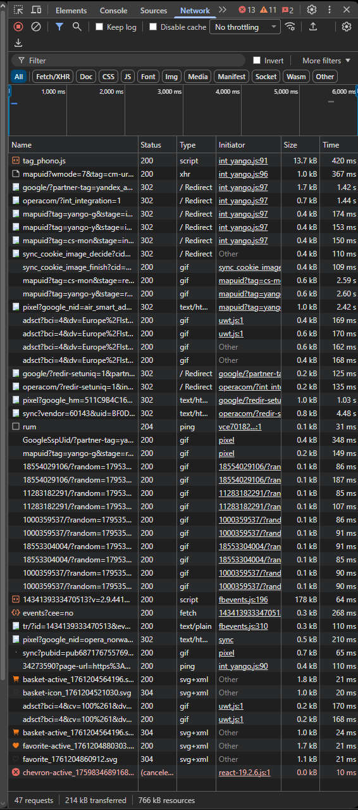
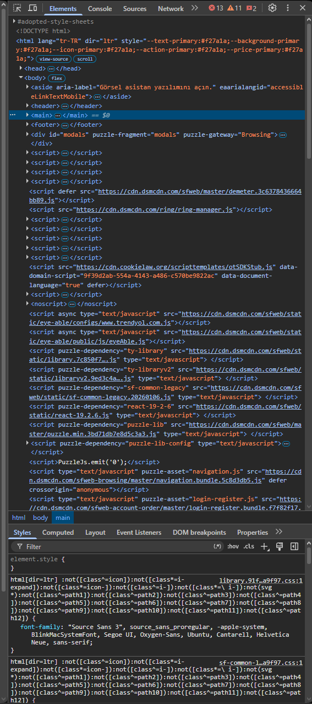
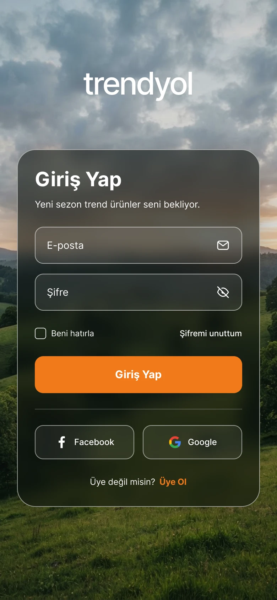

# 10 Haftalık Junior Yolculuğum: GitHub'dan Sosyal Medyaya Uçtan Uca Proje

Bu repo, 10 haftalık eğitim sürecinde öğrendiklerimi tek bir mini projede birleştirdiğim **case study**'dir.
Tasarım + Test + Paylaşım olmak üzere üç parçadan oluşur.

| Parça | Ne yaptım? | Dosya |
|---|---|---|
| Analiz | Trendyol giriş sayfasını DevTools ile inceledim | Bu README, aşağıda |
| Test | Giriş/Kayıt formu için 8 test senaryosu yazdım | [tests/test-senaryolari.md](tests/test-senaryolari.md) |
| Tasarım | Figma'da küçük bir giriş ekranı tasarladım | [figma/ekran-tasarimi.md](figma/ekran-tasarimi.md) |
| İçerik | 1 aylık içerik takvimi + 3 post | [social/](social) |
| Paylaşım | Final sunumu ve Blog #10 | [sunum/](sunum), Blog linki aşağıda |

## 1. Rakip analizi: Trendyol Giriş / Üye Ol sayfası

- İncelenen sayfa: `https://www.trendyol.com/giris`
- Araç: Chrome DevTools, **Elements** ve **Network** sekmeleri
- İnceleme tarihi: 22 Kasım 2026

### 1.1 Elements sekmesinde gördüklerim

- Sayfanın başlığı `<h1>Giriş Yap veya Üye Ol</h1>`. Giriş ve kayıt **tek ekranda** birleşmiş.
- Form `<form method="get" novalidate>` olarak tanımlı. `novalidate` sayesinde doğrulamayı tarayıcı değil, sitenin kendi JavaScript kodu yapıyor.
- E-posta alanı `<input type="email" id="login-email" name="login-email" autocomplete="username">`. `<label for="login-email">E-Posta</label>` ile bağlanmış, bu erişilebilirlik için iyi bir pratik.
- Şifre alanı (`type="password"`, `autocomplete="current-password"`) başta gizli. Önce e-posta soruluyor, kullanıcı **Devam Et**'e basınca şifre veya kayıt adımı açılıyor. Buna **adım adım (progressive) form** denir.
- Alternatif girişler: **Google ile devam et** ve **Facebook ile devam et** butonları.
- Gizli bir `cf-turnstile-response` alanı var. Bu Cloudflare Turnstile, yani bot koruması.
- `<html lang="tr-TR">` ve `meta viewport` tanımlı. Sayfa mobil uyumlu ve dil bilgisi doğru.
- Sayfada 17 adet `data-testid` özelliği var. Bu, sitenin otomasyon testlerine hazır yazıldığını gösteriyor.
- Open Graph etiketleri (`og:title`) var. `ld+json` (yapılandırılmış veri) giriş sayfasında yok, bu normal çünkü sayfa arama motoruna açılmak için yapılmamış.

### 1.2 Network sekmesinde gördüklerim

- Sayfa açılırken yaklaşık **93 kaynak** (resource) yükleniyor. DOMContentLoaded süresi benim ölçümümde yaklaşık **1,1 sn**.
- En büyük dosyalar JavaScript paketleri. En büyüğü `login-register.bundle.*.js` (yaklaşık 213 KB). Sonra menü, OTP ve navigasyon paketleri geliyor.
- Dosyaların çoğu `cdn.dsmcdn.com` adresinden geliyor. Yani Trendyol statik dosyalar için ayrı bir **CDN** kullanıyor.
- API istekleri `apigw.trendyol.com` adresine gidiyor. Bu bir **API gateway**.
- Yanıtlar `br` (Brotli) ile sıkıştırılıyor.
- Üçüncü taraf istekler çok: Google Tag Manager, Google/DoubleClick reklamları, TikTok Analytics, X (Twitter) reklamları, Cloudflare (Turnstile + Insights) ve OneTrust çerez yönetimi. Yani giriş sayfası bile izleme ve reklam script'lerini yüklüyor.
- Güvenlik başlıkları: `Strict-Transport-Security` var (`max-age=15768000`). `Content-Security-Policy` var ama `script-src` içinde `'unsafe-inline'` ve `'unsafe-eval'` geçiyor, bu CSP'yi zayıflatıyor. `X-Frame-Options` başlığını göremedim.
- Sayfa açılırken bir **çerez banner'ı** çıkıyor (Tümünü Reddet / Kabul Et / Ayarlar).

### 1.3 Öğrendiklerim ve kendi tasarımıma etkisi

1. **E-posta önce, şifre sonra** akışı formu sade tutuyor. Kendi tasarımımda da bunu kullandım.
2. Sosyal giriş seçenekleri üye olma sürtünmesini azaltıyor, ekranda form ile **ayırıcı** ("veya") arasında net bir hiyerarşi var.
3. Performans: Tek sayfa için 93 istek çok. Kendi projemde JS paketlerini küçük tutmayı hedefledim.
4. Test: `novalidate` ve özel doğrulama yüzünden hata mesajları tarayıcıya göre değişmiyor. Bu yüzden test senaryolarında net hata metinlerine odaklandım.

> Not: Yukarıdaki bulgular sayfanın o günkü haline aittir, site güncellendikçe değişebilir.
### 1.4 DevTools ekran görüntüleri

**Network sekmesi**



- Alttaki özet çubuğunda **47 istek, 214 kB aktarım, 766 kB kaynak** görünüyor.
- Çok sayıda **302 (Redirect)** isteği ve küçük **gif** istekleri (izleme pikselleri) var. Bunlar reklam ve analiz servislerine ait (`google`, `operacom`, `yango`, `fbevents.js` gibi).
- Kullanıcı bir şey yapmadan bile sayfa arka planda onlarca küçük izleme isteği gönderiyor.
- En büyük kaynak `fbevents.js` (yaklaşık 178 kB), yani bir reklam/izleme script'i.
- Sepet ve favori ikonları `svg+xml` olarak ayrı ayrı yükleniyor. Bazıları `304` ile önbellekten geliyor, bu iyi bir pratik.
- Konsolda 13 hata ve 11 uyarı görünüyor (üstteki sayaçlar).

**Elements sekmesi**



- `<html lang="tr-TR" dir="ltr">` ile dil ve yazı yönü tanımlı. CSS değişkenleri (`--action-primary:#f27a1a` gibi) doğrudan `<html>` üzerinde, yani marka rengi (turuncu) tek yerden yönetiliyor.
- Sayfa yapısı `<aside>`, `<header>`, `<main>`, `<footer>` gibi anlamlı (semantic) etiketlerle kurulmuş. `aside` üzerinde erişilebilirlik için `aria-label` var.
- `puzzle-fragment` / `puzzle-dependency` gibi özel özellikler, sitenin parçalı (**micro-frontend**) bir mimariyle yazıldığını düşündürüyor. Bu benim yorumum, kesin bilgi değil.
- Script'ler arasında `react-19-2-6` görünüyor, yani arayüz React ile çalışıyor.

> Not: Ekran görüntüleri benim 1.1 ve 1.2'deki ölçümümle aynı anda alınmadı. Farklı sayfa, zaman ve önbellek durumu yüzünden sayılar (örneğin 93 istek ile 47 istek) birbirinden farklı çıkabilir.

## 2. Test: Giriş / Kayıt formu

Trendyol giriş formu için 8 senaryo yazdım, 5'ini manuel çalıştırdım: **4 başarılı, 1 başarısız**.
Bulduğum hata (BUG-01): `@` işareti olmayan e-postada kullanıcıya hiçbir uyarı gösterilmiyor.
Detaylar: [tests/test-senaryolari.md](tests/test-senaryolari.md)

## 3. Tasarım: Figma

Component + Auto Layout kullanarak bir giriş ekranı tasarladım.
Adımlar ve ölçüler: [figma/ekran-tasarimi.md](figma/ekran-tasarimi.md)

<p align="center">
  
</p>

Ekranda e-posta ve şifre alanları, "Beni hatırla / Şifremi unuttum" satırı, ana giriş butonu, Facebook ve Google ile giriş seçenekleri ve "Üye ol" bağlantısı yer alıyor.

Figma linki: _(buraya kendi linkini yapıştır)_

## 4. İçerik ve paylaşım

- 1 aylık içerik takvimi (Aralık 2026): [social/icerik-takvimi.md](social/icerik-takvimi.md)
- 3 hazır post (görsel + caption + hashtag + CTA): [social/postlar.md](social/postlar.md)

<p align="center">
  
  
  
</p>
- Sunum: [sunum/sunum-metni.md](sunum/sunum-metni.md)
- Blog #10: _(yayınladığın blog yazısının linkini buraya yapıştır)_

## 5. Repo yapısı

```
junior-yolculugum/
├── README.md
├── docs/            # ekran görüntüleri, GitHub rehberi
├── tests/           # test senaryoları
├── figma/           # tasarım notları
├── social/          # içerik takvimi ve postlar
└── sunum/           # final sunumu
```

## 6. Sonraki adımım

Bir sonraki derinleşme alanım: **Playwright ile test otomasyonu**. Elle yazdığım senaryoları koda dökmek istiyorum.
